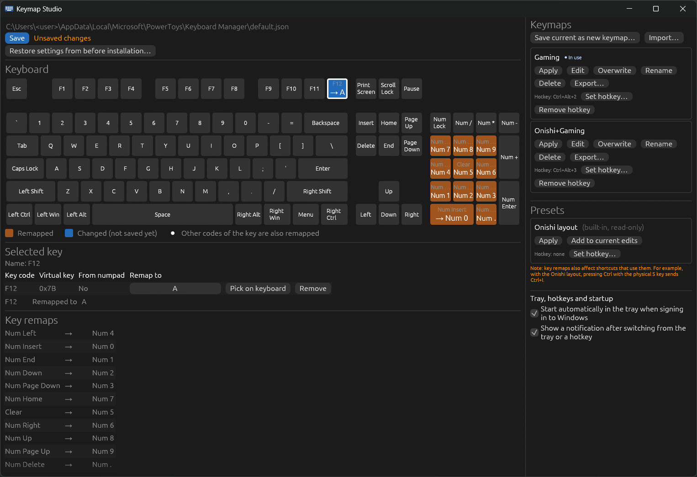

# Keymap Studio

English | [日本語](README.ja.md)

A visual editor for [PowerToys Keyboard Manager](https://learn.microsoft.com/windows/powertoys/keyboard-manager) key remaps on Windows 11. You edit remaps on a picture of the keyboard and switch between whole keymaps with a hotkey.



## Features

- **Edit remaps on the keyboard.** Click a key on the US (ANSI 104) keyboard to remap it. Each remapped key shows its target, such as `F12 → A`. Unsaved changes have their own color.
- **Pick the target your way.** Search by name, browse by category, or click the target key on the keyboard.
- **Numpad keys are handled correctly.** Keymap Studio knows that a numpad key sends different key codes depending on NumLock. For example, it can make the numpad always type digits, even with Shift held (useful in games such as MMOs).
- **Changes take effect immediately.** On save, Keymap Studio tells PowerToys to reload the remaps. You do not need to turn Keyboard Manager off and on.
- **Saving is safe.**
  - Every save keeps a backup of the previous file (the last 10 saves).
  - Files are replaced atomically.
  - Keymap Studio uses the same lock file as the PowerToys editor.
  - If another program changed the file in the meantime, Keymap Studio warns you and does not overwrite it.
- **You can always go back.** On first launch, Keymap Studio backs up your existing PowerToys settings. **Restore settings from before installation…** puts them back.
- **Keymaps.**
  - Save sets of remaps as named keymaps, and apply one in a single click.
  - Each keymap is a single JSON file, so you can export it and import it on another PC.
- **Presets.** The [Onishi layout](https://o24.works/layout/) (a Japanese-optimized English/romaji layout) is built in. You can apply it as is, or add it on top of your current remaps.
- **Tray, hotkeys and startup.**
  - Keymap Studio stays in the system tray.
  - You can give each keymap or preset a global hotkey (for example Ctrl+Alt+1).
  - It shows a notification when the keymap is switched.
  - It can start in the tray when you sign in to Windows.
- **Portable.** A single exe, no installer. All of its data lives next to the exe.

## Requirements

- Windows 11 (x86_64)
- [PowerToys](https://learn.microsoft.com/windows/powertoys/install), with Keyboard Manager turned on at least once.
- Tested with the new Keyboard Manager editor (`useNewEditor: true`).

If PowerToys or the Keyboard Manager settings are missing, Keymap Studio shows what to do instead of editing anything.

## Getting started

1. Download `keymap-studio.exe` from the [Releases](https://github.com/vitivalkoinen/keymap-studio/releases) page.
2. Put it in a folder you can write to, for example `C:\Users\<you>\keymap-studio\`. Keymap Studio stores its data in the same folder.
3. Run it.
   - The exe is not code-signed, so Windows SmartScreen may warn you. Choose **More info → Run anyway**.

On first launch, Keymap Studio backs up your current PowerToys Keyboard Manager settings before it changes anything.

## Usage

### Editing remaps

1. Click a key on the keyboard. This is the key you press (the remap source).
2. Choose what it should become:
   - search the list by name,
   - pick a target from the categories, or
   - click **Pick on keyboard** and then click the target key.
3. Press **Save**. The button is highlighted while there are unsaved changes. PowerToys applies the new remaps right away.

Key colors show the state of each key: no remap, saved remap, or unsaved change.

### Keymaps and presets

- **Save current as new keymap…** saves the remaps on screen as a named keymap.
- **Apply** replaces all PowerToys remaps with the keymap and applies them immediately.
- **Edit** loads a keymap into the editor without applying it. Press **Save** to apply.
- **Overwrite**, **Rename**, **Delete**, **Export…** and **Import…** manage keymap files.
- Presets can be applied, or added to your current edits with **Add to current edits**. Example: numpad digits + Onishi layout. Save the result as your own keymap.
- The keymap or preset that matches the current PowerToys settings is marked **In use**.

Note: PowerToys key remaps also affect shortcuts. With the Onishi layout, pressing the physical S key with Ctrl sends Ctrl+I.

### Tray and hotkeys

- Closing the window (×) hides it to the tray. Your edits are kept.
- To quit, choose **Exit** from the tray menu.
- The tray menu lists your keymaps and presets. Choose one to switch to it.
- Double-click the tray icon to open the window.
- Use **Set hotkey…** on a keymap or preset to assign a global hotkey.
  - A hotkey must include Ctrl, Alt, Shift or Win.
  - Switching with a hotkey discards unsaved edits in the window. The notification tells you when that happens.
- Under **Tray, hotkeys and startup**, you can turn off:
  - starting at sign-in (on by default);
  - the switch notification.
- Only one copy of Keymap Studio runs at a time. Starting it again brings the running window to the front.

### Restoring your original settings

**Restore settings from before installation…** writes back the remap definition that Keymap Studio backed up on first launch. It asks for confirmation first. Use it when you want to undo everything Keymap Studio did.

## Files

Everything is stored in the folder that contains `keymap-studio.exe`:

| Path | Contents |
|---|---|
| `keymaps\` | Your saved keymaps (one JSON file each) |
| `initial-backup\` | PowerToys settings backed up on first launch (never overwritten) |
| `backups\` | The previous remap file from each save (last 10) |
| `keymap-studio.settings.json` | Hotkeys, startup and notification settings |
| `keymap-studio.log` | Activity log |

Keymap Studio writes only one PowerToys file: the active remap definition, `%LOCALAPPDATA%\Microsoft\PowerToys\Keyboard Manager\default.json`. It never modifies PowerToys' `settings.json` or `editorSettings.json`.

To move to another PC, copy the `keymaps\` folder, or use **Export…** and **Import…**.

## Uninstalling

1. If you want your original remaps back, press **Restore settings from before installation…**.
2. Turn off **Start automatically in the tray when signing in to Windows**. This removes the `Keymap Studio` entry from `HKCU\Software\Microsoft\Windows\CurrentVersion\Run`.
3. Choose **Exit** from the tray menu.
4. Delete the folder that contains `keymap-studio.exe`.

## Building from source

You need the Rust toolchain (edition 2024).

```sh
# On Windows
cargo build --release

# Cross-compiling from Linux/WSL (requires mingw-w64)
rustup target add x86_64-pc-windows-gnu
cargo build --release --target x86_64-pc-windows-gnu
```

The exe is written to `target/release/` or `target/x86_64-pc-windows-gnu/release/`. To run the checks:

```sh
cargo test
cargo clippy -- -D warnings
cargo fmt --check
```

The detailed specification, written in Japanese, is in [SPEC.md](SPEC.md).

## Roadmap

- Shortcut remaps and text remaps
- Japanese UI
- JIS keyboard layout

## License

[MIT](LICENSE)

This project is not affiliated with or endorsed by Microsoft. PowerToys is a trademark of Microsoft Corporation. For the Onishi layout and its author, see <https://o24.works/layout/>.
